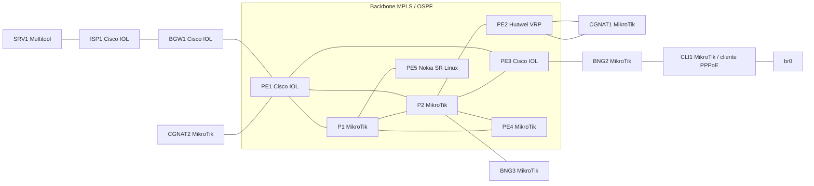

# Laboratório de VRF e VPNv4 para CGNAT

Laboratório de provedor criado com [Containerlab](https://containerlab.dev/) para estudar a separação de clientes e serviços CGNAT em VRFs e a distribuição de rotas VPNv4 pelo backbone MPLS. O objetivo é manter as rotas de cada cliente fora da tabela global do backbone, reduzir o acoplamento entre os serviços e permitir que a solução cresça com a entrada de novos clientes e pontos de acesso.

> Este repositório documenta o cenário e as configurações encontradas. A topologia está montada, mas nem todos os nós têm configuração de serviço completa; consulte [Estado das configurações](#estado-das-configurações) antes de interpretar o laboratório como uma demonstração ponta a ponta já validada.

## Conceito

- **VRF** mantém tabelas de roteamento separadas nos equipamentos de borda. Neste cenário, há uma VRF para o tráfego de CGNAT/BNG e outra para o caminho WAN do CGNAT.
- **VPNv4** permite que os PEs troquem rotas IPv4 identificadas por Route Distinguisher (RD) e controladas por Route Targets (RT), sem inserir essas rotas na tabela global dos roteadores P.
- **MPLS no backbone** transporta o tráfego entre os PEs. O IGP e o LDP são usados no núcleo RouterOS; o PE Huawei tem OSPF e LDP configurados no enlace com o núcleo.
- **Escalabilidade para ISP**: novos clientes ou serviços podem receber VRFs e políticas de importação/exportação próprias, mantendo o núcleo focado em alcançar os PEs.

VRFs e VPNv4 fornecem separação de rotas e encaminhamento entre contextos autorizados. O isolamento depende dos RTs e das políticas configuradas; essas tecnologias, por si só, não substituem controles de segurança ou filtragem.

## Topologia



O diagrama representa os enlaces físicos declarados em `lab-multi.clab.yml`; ele não implica que todos os protocolos e sessões estejam operacionais. O SRV1 é apenas um host de teste baseado na imagem `ghcr.io/srl-labs/network-multitool:latest`, ligado ao ISP1. Não é um servidor de produção nem participa da distribuição VPNv4.

## Equipamentos

| Nó | Plataforma / função no cenário |
|---|---|
| PE1, PE3, BGW1, ISP1 | Cisco IOL; borda do backbone e rede externa de teste |
| P1, P2, PE4, CLI1, CGNAT1, CGNAT2 | MikroTik RouterOS |
| BNG2, BNG3 | MikroTik RouterOS 7; agregação de assinantes/BNG |
| PE2 | Huawei VRP NE40E; PE com VRFs e família VPNv4 configuradas |
| PE5 | Nokia SR Linux; nó adicional no backbone |
| SRV1 | Linux com Network Multitool, para testes |
| br0 | Bridge Open vSwitch ligada ao CLI1 |

## Configurações relevantes encontradas

No PE2 Huawei, `PE2/config/startup-config.cfg` define:

| Instância VPN | RD | RT de exportação | RT de importação | Uso indicado pela configuração |
|---|---:|---:|---:|---|
| `VRF-CGNAT1-BNG` | `100:100` | `100:1` | `100:11` | Enlace de serviço com CGNAT1 e peer eBGP `10.100.0.6` |
| `VRF-WAN-CGNAT` | `101:1` | `101:1` | `101:1` | Enlace WAN com CGNAT1 e peer eBGP `10.1.0.2` |

O mesmo PE2 ativa BGP AS `65500`, habilita a família `ipv4-family vpnv4` e estabelece peers VPNv4 com os endereços `10.255.0.1` (PE1) e `10.255.0.5` (PE3), com anúncio de communities. Seu enlace `Ethernet1/0/0` com P2 participa do OSPF área 0 e MPLS/LDP.

O CGNAT1 RouterOS está configurado no AS `65501`. Ele anuncia `192.168.48.0/26` no peer WAN e usa filtros de saída separados para esse prefixo e para a rota default no peer ligado à VRF de BNG. O BNG2 RouterOS 7 cria a VRF `CGNAT`, um perfil e pool PPP, servidor PPPoE e uma sessão eBGP na tabela dessa VRF. O CLI1 tem cliente PPPoE configurado com o usuário de laboratório `cli1`.

P1 e P2 têm loopbacks, OSPF ponto a ponto e LDP configurados. O P2 também conecta diversos nós de borda, servindo como ponto central do núcleo. Os demais enlaces e papéis podem ser consultados diretamente no YAML da topologia.

## Estado das configurações

Os arquivos de configuração mostram um cenário em desenvolvimento. A configuração do PE2 contém VRFs, RTs, RD, VPNv4, OSPF e LDP; CGNAT1, BNG2, CLI1, P1 e P2 também têm trechos de serviço ou transporte configurados. Porém:

- Os arquivos de boot de PE1, PE3, BGW1 e ISP1 contêm principalmente configuração inicial/gerência, sem a configuração de serviço necessária para confirmar o percurso completo.
- CGNAT2 e BNG3 têm configuração de serviço mínima nos arquivos persistidos.
- Os arquivos `ansible-inventory.yml`, `nornir-simple-inventory.yml` e `.state.clab.yaml` são artefatos gerados pelo Containerlab, não uma fonte única da verdade para a configuração de rede.

Por isso, o objetivo é demonstrar segregação por VRF e troca VPNv4, mas uma validação ponta a ponta e a ausência real de vazamento devem ser verificadas após completar e conferir as configurações dos PEs e as políticas de RT.

## Pré-requisitos

- Docker em execução.
- Containerlab instalado.
- Imagens dos nós disponíveis localmente ou acesso para baixá-las. As referências de imagem e versões estão em `lab-multi.clab.yml`.
- Recursos suficientes para executar roteadores virtuais, especialmente o PE Huawei, que declara 3 GB de memória e 2 vCPUs.

## Executar o laboratório

Na raiz deste repositório:

```bash
containerlab deploy -t lab-multi.clab.yml
containerlab inspect -t lab-multi.clab.yml
containerlab graph -t lab-multi.clab.yml
```

Para encerrar e remover os nós:

```bash
containerlab destroy -t lab-multi.clab.yml
```

O arquivo principal declara a rede de gerenciamento `172.30.20.0/24`. As interfaces de gerenciamento e seus endereços são criados pelo Containerlab; os endereços de serviço devem ser consultados nas configurações de cada nó.

## Acesso

As credenciais de laboratório informadas para os equipamentos são:

```text
Usuário: admin
Senha:   admin
```

O SRV1 é um container Linux; acesse-o com `docker exec`:

```bash
docker exec -it clab-lab-multi-SRV1 sh
```

## Verificações sugeridas

Use os comandos equivalentes à plataforma para confirmar estado de interfaces, vizinhanças, rotas e sessões. A sintaxe pode variar conforme a versão da imagem.

**Huawei PE2:**

```text
display ospf peer brief
display mpls ldp peer
display bgp vpnv4 all peer
display ip routing-table vpn-instance VRF-CGNAT1-BNG
display ip routing-table vpn-instance VRF-WAN-CGNAT
```

**MikroTik P1/P2:**

```text
/routing ospf neighbor print
/mpls ldp neighbor print
/ip route print
```

**MikroTik BNG2:**

```text
/routing bgp session print
/ip route print detail where routing-table=CGNAT
/ip vrf print
```

Para verificar a segregação, confira que as rotas de cliente aparecem na VRF esperada e que os nós P do backbone mantêm apenas as rotas necessárias ao transporte (por exemplo, loopbacks e enlaces do IGP), sem importar as rotas de assinantes para a tabela global. Faça também testes de conectividade entre o CLI1, BNG2, CGNAT1 e SRV1 conforme os caminhos que forem configurados.

## Arquivos principais

- `lab-multi.clab.yml`: definição de nós, imagens, enlaces e rede de gerenciamento.
- `clab-lab-multi/<nó>/`: configurações de boot/startup usadas ou persistidas por cada nó.
- `clab-lab-multi/PE2/config/startup-config.cfg`: VRFs, RD/RT, VPNv4, OSPF, LDP e BGP do PE Huawei.
- `clab-lab-multi/{P1,P2}/ftpboot/config.auto.rsc`: configuração RouterOS do núcleo OSPF/LDP.
- `clab-lab-multi/{CGNAT1,BNG2,CLI1}/ftpboot/config.auto.rsc`: configurações de serviço CGNAT, BNG e cliente PPPoE.
